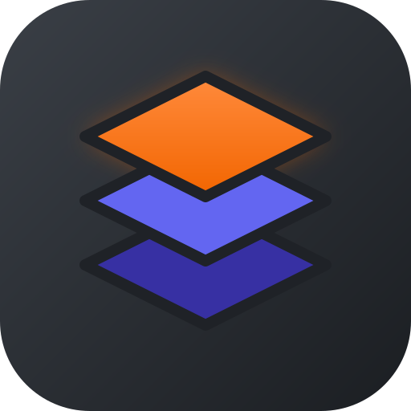

# CodeDeck

**AI session radar for Linux.** Say “Codeck” – that is also the command: `codeck`.

CodeDeck runs beside your AI coding sessions: it shows what each session is doing and what it changed,
keeps a snapshot before every turn to go back to, and attaches exactly what you choose to your next
prompt. Not an editor: files open in small external viewers.

Part of [be spex](https://bespex.github.io) – small, focused apps for Linux. Works together with the
[Qiew viewers](https://github.com/bespex/Qiew) (Marq, Jayq, Dirq …).

> Early development. Real: the file list, Git (status, changes, history and the everyday actions)
> for every repository in the project, and the bridge to Claude Code (sessions, snapshots, comments
> for the assistant, focus), the Workbench, the sidebar. Not built yet: the timeline in Activity.

## Layout

| Column | What it is |
| --- | --- |
| **Files** | The project tree. A cyan dot marks files the assistant changed. Every folder in the path above it, and every folder in the tree, can become the project; `Ctrl+click` opens it in a new window instead. |
| **Deck** | The working surface, with four views, each for one question (Activity: what are the sessions doing; Changes: what did the assistant change; Workbench: what else came up; Next prompt: what is attached to your next prompt), and the **Trail**: the Git history of all repositories as one vertical line. Hovering opens it to the left, over the file list, into a timeline; a point shows what that commit changed, with its details on top. The line shows how safe the work is: amber while not committed, faint amber with hollow amber rings while committed but not pushed, grey with filled points once on a remote. Three or more snapshots in a row fold into one point with their number; a click opens them. Every symbol explains itself in a tooltip. The newest pushed commit of each repository carries its remote's name with what is left to push and pull (`origin ↑2`). A spark marks commits made with an assistant (from their `Co-authored-by` trailer); an anchor marks a snapshot (see below). Ctrl+click a second point of the same repository to see what changed between the two. Where [Dirq](https://github.com/bespex/Qiew) is installed, a commit, a snapshot or a comparison opens in it side by side. |
| **Header bar** (top of the right column) | The project: its name switches to a recent project or opens a folder (`Ctrl+O`) here or in a new window (`Ctrl+Shift+O`), copies its path, shows it in the file manager. *Quick settings*: do not disturb, notifications, language, the AI tool's connection, *All settings…* (`Ctrl+,`). The menu `⋯`: About, keyboard shortcuts (`F1`), help, git commands, report a problem, *Copy diagnostics* (version, desktop, connections, the last hook messages, for a bug report), new window. The button at the far right makes CodeDeck a sidebar. |
| **Sidebar** (`Ctrl+Shift+L`, from anywhere `Ctrl+Alt+L`) | Only the right column, narrow at the right edge of the monitor CodeDeck is on, as high as the panels leave free; the column is the same as in the full window, with its short overview on top (branch and open files, turns and the last snapshot, hints, new scratch files, what was left outside). Anything that needs the file list or a view brings the full window back, where it was. `Ctrl+Alt+C` shows CodeDeck from anywhere and hides it again; with several windows one press acts on all. |
| **Sessions** and **Next prompt** | The Claude Code sessions working in the project, each with its latest prompt and the files it wrote (a click shows the file); and what is attached to your next prompt. You write the prompt in Claude; CodeDeck only attaches what is listed here. Nothing attached, Claude works without extra context. |

A project is a directory with an optional `.codedeck.toml`. No index, no project folder. Each window is
its own process with its own project, so several projects can be open side by side; they share only
the list of recent projects in `~/.config/codedeck/recent.json`.

Git runs through the `git` command line, so your configuration, hooks and credentials apply, and
the command that ran is always shown (status bar, tooltips). A project may hold several
repositories: the one it lies in, and any found up to three folders below it, e.g. a workspace
folder with one repository per subfolder. Each shows its branch on its folder in the tree, tinted
while there are uncommitted changes; a click there (or on the branch in the status bar) offers
commit, pull, push and fetch. Pointing at an action shows the exact git command before it runs,
and its output afterwards. Linked worktrees are recognised and marked, not managed.

**Changes** shows the uncommitted changes of every repository, with a commit line per repository,
in two ways. **Structure** (the default) is a tree of what changed in shape: new, deleted, moved and
renamed files and folders, and those only edited inside; Git's rename detection recognises moves,
also of files not yet added (through a scratch copy of the index, the real one stays untouched).
The counts on top filter the tree; a click on a file opens its diff in place. **Code** shows every
diff, file after file. Each file can be staged, unstaged or discarded (after asking); hovering an
action shows its command. The same view shows a commit picked on the trail.

The message of a commit not on any remote yet can be changed in place (the pencil next to it):
the newest one with `git commit --amend --only`, an older one with an `amend!` commit and
`git rebase -i --autosquash --autostash`, which runs without an editor. Pushed commits and
commits behind a merge are left alone.

## Claude Code

CodeDeck does not run the assistant; Claude Code does, in its terminal or desktop app. CodeDeck
watches alongside. **Connect** (click *Claude* in the status bar) adds hooks to a Claude Code
configuration's `settings.json` that run `codeck hook`. Every configuration is listed and
connected on its own: `~/.claude`, the one `$CLAUDE_CONFIG_DIR` names, and other `~/.claude-*`
folders that are one, since a session only reports through the configuration it runs with. That passes each
event, without file contents, to the socket every CodeDeck window keeps in
`$XDG_RUNTIME_DIR/codedeck/`; a window only takes in what concerns its project. Nothing else in
the settings changes, the file as it was is kept as `settings.json.before-codedeck`, and
*Disconnect* takes the hooks out again. Without a CodeDeck window open the hook does nothing.

- **Needs you:** on top of the right column, the sessions that ask something (a permission, a
  question) and those that finished their turn; the latter can be put aside and leave by themselves
  after half an hour. The window title counts them. While you look elsewhere, CodeDeck tells you about a new one in
  the taskbar and with a desktop notification (a click brings the window back); what counts and how is
  chosen in the quick settings (top right), where *Do not disturb* also pauses them for a while.
- **Sessions:** below, the sessions working in the project in two lines each: title and state, then
  what counts right now (the step it is at, its question, what it wrote). Prompt, model and the files it
  wrote fold out; those files carry the dot in the file list. Sessions that ended, never reported or have
  been idle for hours are folded away under *Earlier*; *Remove from list* takes one out until its next step. Sessions of the last day are read from Claude Code's logs
  (`<configuration>/projects/`), so they appear even when they started before CodeDeck. The status bar counts
  them and shows when one waits for you. Each session has a colour and a short name (A, B, C …) that it
  keeps wherever it shows up: in the list, on its snapshots on the trail, on the dot of the files it
  wrote. Hovering a session makes its snapshots and files stand out. The list is in the order the sessions
  came in and does not jump; the pencil gives a session a title and short name of your own, kept per
  project in `~/.config/codedeck/sessions.json`.
- **Snapshots:** before a session writes for the first time in a turn (a file edit, or any shell
  command), CodeDeck keeps the repository's working tree, untracked files included, as a commit
  under `refs/codedeck/snapshots/`. That goes through a copy of the index: the real index, the
  branches and what you push stay untouched (`git log --all` does show them). Snapshots since a
  repository's last commit appear on the trail (*only this session* hides those of other sessions);
  picking one shows what changed since, and **Go back to here** puts the files back, after keeping the present as a snapshot of its own, so going back
  can be undone the same way. 50 per repository are kept, for 14 days.
- **Comments for the assistant:** in whatever editor, begin a line with `@ai …`, or begin it with
  a comment whose text starts with `@ai` (`<!-- @ai …`, `// @ai …`, `# @ai …`). Text before it on
  the line, or a Markdown code block around it, makes it no hint. The **Workbench** view collects them (with
  `git grep`, so ignored files stay out) in a tile of their own; the paperclip at a hint **attaches** it to
  the next prompt of the session you choose (or of whichever session in the project prompts first), or
  they are copied as a task. Comments that are gone afterwards count as done. The documents the assistant
  wrote recently are in the **Activity** view.
- **Workbench:** what came up that is not part of the project yet, in tiles. The **scratch folder**
  `.scratch/` is for drafts, mock-ups, throwaway scripts and test data; CodeDeck adds it to
  `.git/info/exclude` (never `.gitignore`), so git leaves it alone. Its tile lists the files with size, age
  and the session that wrote them; drag one onto a folder in the file list to move it into the project, or
  send it to the trash (also everything older than 7 days). The second tile holds the `@ai` hints.
  **Outside the project** (only while there is some) lists files a session of the project wrote outside of it
  and outside every repository (in `/tmp`, the home folder, the assistant's plans; also what a shell command
  sends there with `>` or `tee`), where *Into scratch* copies one into the scratch folder, and pages it put
  **online** (claude.ai, gists, pastes), as it named them at the end of its turn. Tiles come in the order of
  what wants a decision (outside, hints, scratch), can be closed and show long lists in part; the scratch
  folder is a tree whose folders can go to the trash as a whole.
- **Start rules:** a few short, fixed rules every new session gets when it starts (today: put temporary
  things into `.scratch/`, and name a page published elsewhere with its link). Always on, shown word for word in the **Next prompt** view, apart from the attachments.
- **Attaching files:** click the paperclip of a file or folder (or drag it onto Next prompt) and it is
  attached: Claude gets its path with the next prompt and reads what it needs. Files, changes, line
  comments and hints can be attached together; all go with the same prompt, and then the list is empty again.
  The **Next prompt** view lists every attachment with where it comes from, the exact text, and the start
  rules; the right column sums it up (how many of each, tokens, who it is for) and opens that view.
- **Attaching changes:** the paperclip on a turn, commit, snapshot, comparison or the uncommitted changes, or on
  one file of them, attaches the git command that shows the change (not the diff itself). What a session got
  from CodeDeck is listed in its details.

**Language:** the interface is in English or German, following the system; switch it in the quick settings
(top right) or in the settings. What the assistant gets stays in English.

**Git commands** (click *git* next to the branch in the status bar, or Ctrl+Shift+G) lists every git
command CodeDeck ran with what git printed and its exit code. Commands that changed something stand
out and can be shown alone; the status check every few seconds only appears when it fails; failed commands
open by themselves.

Hovering a row of the file list shows its tools: view and edit (default program), show in the
file manager, open a folder as project, and pin or unpin it for the assistant. A right click on a
file or folder (in the file list and in the structure view) offers the same outside actions.

The right mouse button is kept for CodeDeck's own menus; Shift + right click opens the web view's
menu (developer tools).

## Build from source

Tauri 2 (Rust) with React, TypeScript, Vite and Tailwind CSS.

```sh
./dev                  # start from source, opens the directory you are in
./dev ~/projects/foo   # open another project
./dev --link           # once: makes `codeck-dev` available in every directory
```

`./dev` installs dependencies when needed and starts with hot reload: frontend changes appear
immediately, Rust changes rebuild and restart the window.

```sh
npm run tauri build    # .deb and AppImage
```

A package built locally only runs on systems with the same or a newer glibc. Releases are
therefore built by GitHub Actions on Ubuntu 24.04 ([`.github/workflows/release.yml`](.github/workflows/release.yml)):

1. Bump `version` in `src-tauri/tauri.conf.json`, `src-tauri/Cargo.toml` and `package.json`.
2. Commit, then tag and push: `git tag v0.2.0 && git push origin v0.2.0`
3. The workflow tests, builds the `.deb` and the AppImage and publishes a GitHub release with
   both and `SHA256SUMS`. Started by hand (Actions → Release → Run workflow) it only builds and
   keeps the packages as workflow artifacts.

Logo candidates: `design/logos/index.html`.
